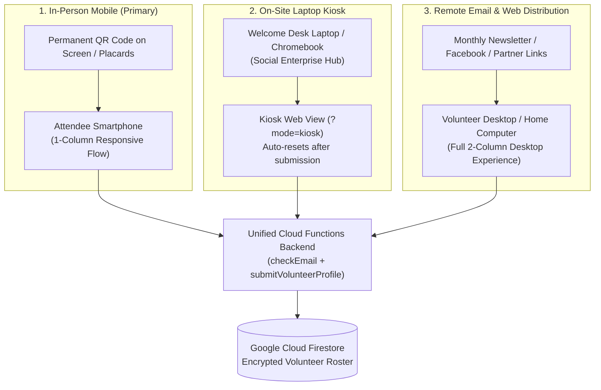

# Civic Tech Saint John (CTSJ) — Volunteer & Project Intelligence Platform
## Complete System Architecture, Data Schema, and Engineering Blueprint (v2.1)

> **Prepared For:** Civic Tech Saint John Steering Committee & Engineering Team  
> **Community Partner:** Human Development Council (HDC) / Code for Canada Network  
> **Meeting Venue:** Social Enterprise Hub, 139 Prince Edward St, Saint John, NB  
> **Status:** Multi-Device Spec (Mobile, Desktop & On-Site Kiosk Station)

---

## 1. Executive Summary & Delivery Channels

Civic Tech Saint John (CTSJ) convenes weekly (Tuesdays, 6:30–8:00 PM) to build open-source civic tools for Greater Saint John. 

To maximize accessibility and ensure **no barrier to entry**, the volunteer intake system supports three distinct distribution channels:



1. **In-Person Mobile (QR Code):** Attendees scan the permanent QR code on the projector or tabletop cards using their smartphones.
2. **On-Site Laptop Kiosk Station:** For attendees without a smartphone, with limited battery, or who prefer typing on a physical keyboard, a dedicated laptop/Chromebook is set up at the welcome desk (next to the pizza/refreshments).
3. **Remote Email & Social Distribution:** The same permanent URL (`civictechsaintjohn.ca/join`) can be blasted in email newsletters, shared on Facebook/LinkedIn, or linked on the website for digital onboarding anytime.

---

## 2. Desktop vs. Mobile Layout Architecture

The application uses a unified, responsive frontend (Next.js / React + Tailwind CSS):

### Desktop Layout (Widescreen / Laptop Kiosk)
```
+---------------------------------------------------------------------------------------------------+
|  [Logo] CIVIC TECH SAINT JOHN                     Volunteer & Community Intake Roster             |
+-------------------------------------------------+-------------------------------------------------+
| LEFT COLUMN: Contact & Profile Details          | RIGHT COLUMN: Skills & Availability             |
|                                                 |                                                 |
| Email Address (*) [ jane.doe@example.com      ] | Skills (Optional)                               |
| [!] "You are already in our database! Would     | [Python] [React] [GIS Mapping] [UI/UX] [+ Add]  |
|      you like to update your profile?"          |                                                 |
|                                                 | Smart Skills Paste (Optional)                   |
| First Name (*)    [ Jane                      ] | +---------------------------------------------+ |
| Last Name (*)     [ Doe                       ] | | Paste your bio, resume bullets, or LinkedIn | |
| Phone (Optional)  [ +1 506-555-0199           ] | | summary here to auto-extract tags...        | |
| Role (Optional)   [ Volunteer               v ] | +---------------------------------------------+ |
| City (Optional)   [ Saint John, NB          v ] | [ Auto-Extract Skills ]                         |
|                                                 |                                                 |
|                                                 | Availability (Optional)                         |
|                                                 | Days: Mon | [Tue] | Wed | Thu | Fri | [Sat] | Sun |
|                                                 | Slots: Morning ( ) | Afternoon ( ) | Evening (*)  |
+-------------------------------------------------+-------------------------------------------------+
| BOTTOM FULL WIDTH: Consent & Submission                                                           |
| [X] I agree to the Civic Tech Saint John Volunteer Terms & Community Guidelines (*)               |
| [X] I consent to receive email updates regarding projects, meetings, and calls for skills (CASL)  |
|                                                                                                   |
| [            SUBMIT PROFILE / UPDATE            ]   [ Reset Form / Register Another Volunteer ]    |
+---------------------------------------------------------------------------------------------------+
```

---

## 3. On-Site Shared Laptop: "Kiosk Mode" & PII Security

> [!CAUTION]
> When multiple attendees use the same physical laptop at the meetup welcome table, preventing the next person from seeing the previous person's personal email, phone number, and name is a **critical PII requirement under PIPEDA**.

### Kiosk Safeguards (`?mode=kiosk`):
1. **Automatic Form Sanitization (10-Second Auto-Reset):**
   * After submission, a prominent green confirmation screen appears: *"Thank you, Jane! Your profile has been recorded."*
   * A 10-second countdown runs, after which the form automatically wipes all memory, caches, and form fields, returning to a blank screen for the next attendee.
   * An instant **"Register Next Volunteer Now"** button allows immediate clearing without waiting.
2. **Browser Autofill Suppression:**
   * Form inputs use `autocomplete="off"` and `autocorrect="off"` to prevent the browser from saving or suggesting previous names, emails, or phone numbers.
   * The laptop browser should be launched in **Guest Mode** or **Incognito**.
3. **No Sensitive PII in Client Memory:**
   * The `checkEmail` lookup returns only the profile associated with that specific email; it never lists or caches other volunteers in local storage.

---

## 4. Remote Email & Web Distribution Strategy

The permanent intake link can be distributed across digital channels with standard UTM campaign parameters:

* **Official Permanent URL:** `https://civictechsaintjohn.ca/join`
* **Email Newsletter Link:** `https://civictechsaintjohn.ca/join?utm_source=newsletter&utm_medium=email`
* **Facebook / Social Link:** `https://civictechsaintjohn.ca/join?utm_source=facebook&utm_medium=post`
* **Meeting Projector / Placard:** `https://civictechsaintjohn.ca/join?utm_source=qr&utm_medium=in_person`

The backend tracks `signupSource` so the steering committee knows which channel brings in the most volunteers.

---

## 5. Technical Specification & Field Rules

### Mandatory vs. Optional Fields
* **Mandatory:** `email` (lowercase normalized), `firstName`, `lastName`, Terms & Conditions checkbox.
* **Optional:** `tel` (phone), `role`, `city`, `skills` (tags + bio parser), `availability` (days & slots), CASL email opt-in.

### Database Upsert Behavior:
* If email does not exist: Creates a new volunteer document in `volunteers/{email}`.
* If email already exists: Merges and updates the volunteer document, stamping `updatedAt: serverTimestamp()`.
* **Zero friction:** One single **"Submit Profile"** action.

---

## 6. Full Code Implementation References
* **Backend API & Kiosk Endpoints:** [`backend/cloud_functions_sample.js`](./backend/cloud_functions_sample.js)
* **Google Sheets Webhook Sync:** [`scripts/google_apps_script_sync.js`](./scripts/google_apps_script_sync.js)
* **Client-Side Skills Tokenizer:** [`frontend/skills_parser.js`](./frontend/skills_parser.js)
