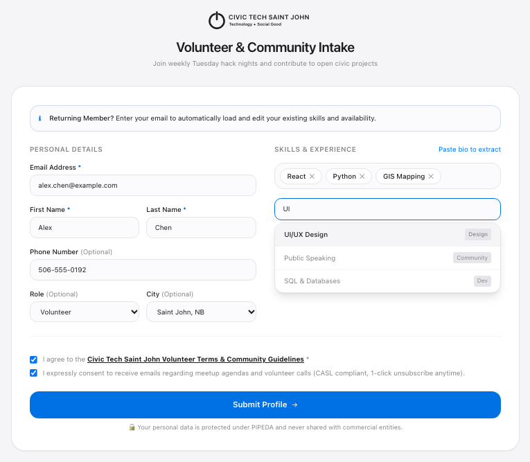
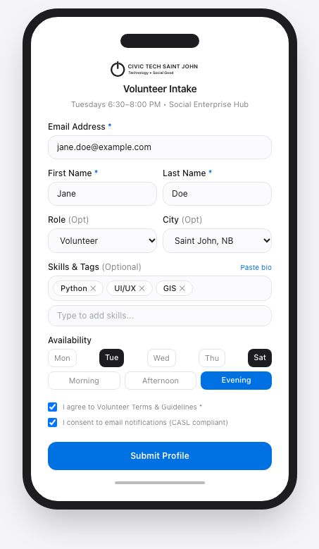
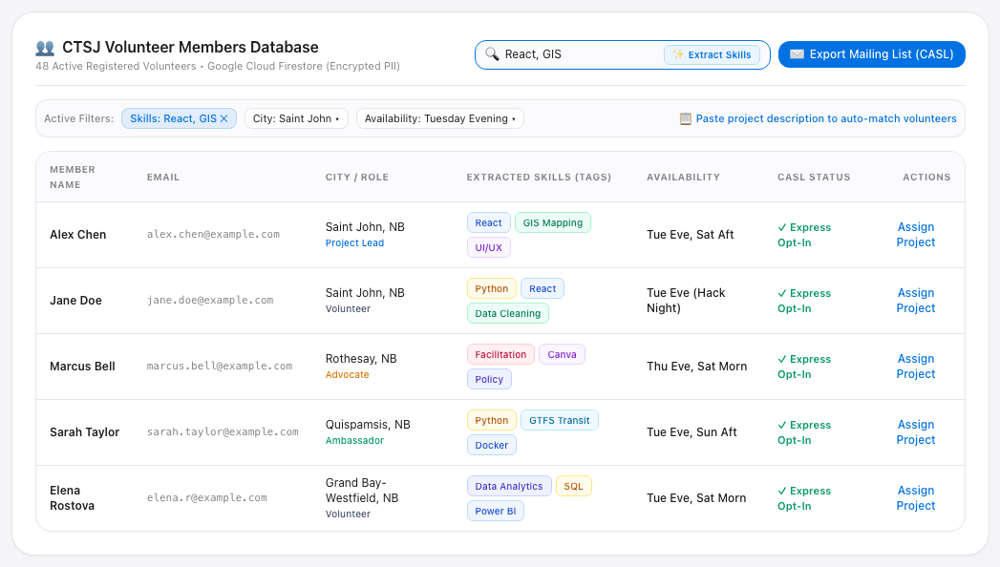
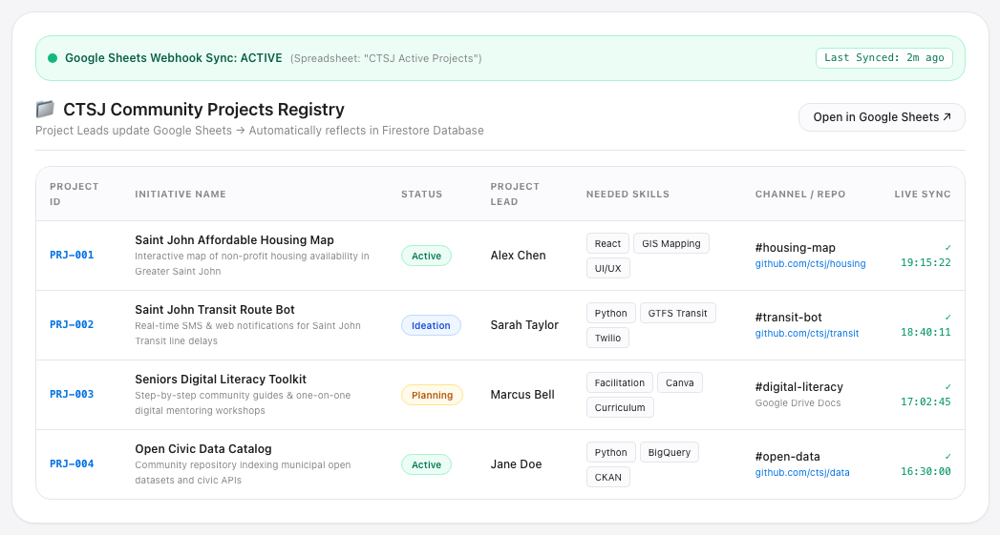

# Civic Tech Saint John (CTSJ) — Volunteer Roster & Projects Platform

> **Community Initiative:** Civic Tech Saint John (Supported by Human Development Council)  
> **Weekly Hack Nights:** Tuesdays 6:30 PM – 8:00 PM @ Social Enterprise Hub (139 Prince Edward St, Saint John, NB)  
> **Target Completion:** **Tue Dec 1, 6:00 PM**

---

## 📌 Executive Overview

Civic Tech Saint John brings together volunteers, tech workers, students, and community advocates to build open-source tools for social good in Greater Saint John.

This repository contains the architecture, data schemas, frontend components, and Google Cloud integration scripts for the **CTSJ Volunteer Talent Roster & Projects Sync Platform**.

* 📄 **[Download the 1-Page PDF Blueprint (CTSJ_PLATFORM_ONE_PAGER.pdf)](./CTSJ_PLATFORM_ONE_PAGER.pdf)**
* 📋 **[Read the Executive One-Pager (CTSJ_PROJECT_ONE_PAGER.md)](./CTSJ_PROJECT_ONE_PAGER.md)**
* 🏗️ **[System Architecture & Data Schemas (CTSJ_SYSTEM_ARCHITECTURE_MAP.md)](./CTSJ_SYSTEM_ARCHITECTURE_MAP.md)**
* 🤝 **[Async Contribution Guide (TEAM_CONTRIBUTION_GUIDE.md)](./TEAM_CONTRIBUTION_GUIDE.md)**
* 💻 **[Interactive Browser Prototype (docs/ctsj_interactive_mockups.html)](./docs/ctsj_interactive_mockups.html)**

---

## 📸 System Visuals

| Desktop Web Form | Mobile Smartphone View |
| :---: | :---: |
|  |  |
| **Volunteer Members Database** | **Projects & Google Sheets Sync Hub** |
|  |  |

---

## ☁️ Google Cloud Standard Always-Free Tier

Because CTSJ is an unincorporated volunteer club, the entire platform runs on Google's permanent **"Always Free" Tier** with zero non-profit paperwork and zero cost ($0.00/mo):

* **Google Cloud Firestore (Database):** 50,000 reads/day, 20,000 writes/day, 1 GB storage.
* **Google Cloud Functions (API):** 2,000,000 free invocations/month.
* **Google BigQuery (Analytics):** 10 GB storage, 1 TB query processing/month.
* **Google Sheets & Apps Script:** Free with any standard Google account (20,000 webhook fetches/day).
* **Firebase Web Hosting:** 10 GB storage, 360 MB/day transfer, free automated SSL.

---

## 🔒 Privacy & Compliance (PIPEDA & CASL)

* **PIPEDA:** Data minimization (no SIN, birthdates, or unnecessary private data collected). AES-256 encryption at rest, TLS 1.3 in transit. Role-based access control prevents public queries of personal member emails.
* **CASL (Anti-Spam):** Explicit, un-checked email opt-in checkbox, audit trail logged in DB, physical address disclosure, and 1-click unsubscribe.
* **Shared Laptop Kiosk Mode (`?mode=kiosk`):** 10-second auto-reset countdown after submission and browser autofill suppression for shared welcome table laptops.

---

## 📁 Repository Structure

```text
ctsj/
├── README.md                          # Repository overview & quick links
├── CTSJ_PLATFORM_ONE_PAGER.pdf        # Print-ready 1-page executive PDF
├── CTSJ_PROJECT_ONE_PAGER.md          # Markdown executive summary
├── CTSJ_SYSTEM_ARCHITECTURE_MAP.md    # Detailed technical architecture & schemas
├── TEAM_CONTRIBUTION_GUIDE.md         # Async contribution roadmap & Git guide
├── backend/
│   └── cloud_functions_sample.js      # Cloud Functions endpoints (lookup, upsert, sync)
├── frontend/
│   ├── VolunteerIntakeForm.jsx        # Clean React component with bottom submit button
│   └── skills_parser.js               # Client-side skills NLP tokenizer & taxonomy
├── scripts/
│   └── google_apps_script_sync.js     # Google Sheet onEdit auto-sync webhook script
└── docs/
    ├── ctsj_interactive_mockups.html  # Interactive 4-in-1 browser prototype
    └── images/                        # High-resolution screenshots & official logo assets
```
